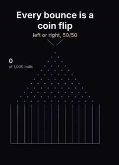
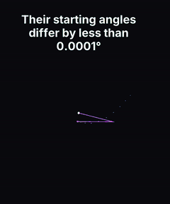

# Science Shorts simulations

The code behind two animated science Shorts: the simulations, the frame-by-frame animation, and
sound that is generated *from* the simulation (every note is caused by something you can see).

| Galton board | 1,000 double pendulums |
| --- | --- |
|  |  |

*(The GIFs are silent previews; the rendered MP4s have the sound.)*

## Quick start

You need Python 3.9+, [ffmpeg](https://ffmpeg.org/download.html) on your PATH, and pycairo. On Windows
pip installs pycairo with cairo included. On macOS run `brew install cairo pkg-config` first, and on
Debian/Ubuntu `sudo apt install libcairo2-dev pkg-config python3-dev`.

```bash
pip install -r requirements.txt

python galton.py          # -> out/galton.mp4    (36 s, 1080x1920, with sound; about half a minute to render)
python pendulum.py        # -> out/pendulum.mp4  (34 s, with sound; a minute or two)
```

Useful options (both scripts):

```bash
python galton.py --preview 0,8,22     # just a few still frames as PNGs, in seconds
python galton.py --no-sound --gif     # video only, plus a small preview GIF
python galton.py --seed 42            # a different random run of the Galton board
python galton.py --variant glass      # glass/bell instruments instead of mallets
python pluck.py pluck-demo.wav        # demo of the string-pluck sounds used for the string art video
```

## What's simulated

**Galton board** (`galton.py`). 1,000 balls drop through 12 rows of pegs. At every peg a ball goes
left or right with probability 1/2, so the bin it lands in is the number of "rights": a binomial
distribution, which the central limit theorem says looks like a bell curve. The gold curve drawn
over the bins is the normal distribution with the same mean (6) and variance (12 × ¼ = 3), scaled to
1,000 balls. The board is idealised: fair coin flips, not bouncing-ball physics.

**Double pendulums** (`pendulum.py`, physics in `dp_sim.py`). 1,000 double pendulums with equal
masses and 1 m massless rods, no friction, integrated with 4th-order Runge-Kutta (40 substeps per
frame). The lower arms start at 2.4 rad with a total spread of one millionth of a radian (less than
0.0001°) across all 1,000. For about 9 seconds they move as one; then the tiny differences grow
exponentially and they fly apart. The total energy is printed as a check on the integrator (it drifts
by less than 1e-7). `python dp_sim.py` prints divergence times for a few starting angles and spreads.

## Sound

All sound is synthesized with numpy: no samples, no music, so no licensing questions.
`galton_sound.py` and `pendulum_sound.py` turn simulation events into notes:

- **Galton:** each peg hit plays a note whose pitch is the ball's left-right position (on a pentatonic
  scale), so every ball's path is a tiny melody; landings play chord tones by bin, louder for faster
  falls; the curve being drawn plays a rising arpeggio shaped like the bell curve, resolving on a chord.
- **Pendulums:** each time an arm turns around or swings over the top it plays a marimba note pitched
  by its speed. While all 1,000 are in sync they sound as single crisp notes; as chaos sets in the
  notes scatter.

The mixes are mastered to about −14 LUFS and loop seamlessly, like the videos. The design rules, the
research behind them and the exact mappings are in [docs/SOUND-DESIGN.md](docs/SOUND-DESIGN.md).
The reusable toolkit is the `sound/` package (scales, instruments, mixing and mastering) and
`pluck.py` (Karplus-Strong string plucks).

## Files

| File | What it is |
| --- | --- |
| `galton.py` | Galton board simulation and animation; renders the video and calls the sound |
| `galton_sound.py` | Sound for the Galton board, from the simulation events |
| `pendulum.py` | Double-pendulum animation; renders the video and calls the sound |
| `pendulum_sound.py` | Sound for the pendulums, from the simulation events |
| `dp_sim.py` | Double-pendulum equations of motion, RK4 integrator and energy |
| `common.py` | Video helpers: cairo frames into ffmpeg, easing, captions in the Shorts safe area |
| `sound/` | Sonification toolkit: `scales.py`, `instruments.py`, `mix.py` |
| `pluck.py` | String-pluck sound effects (pitch from line length) used for the string art video |
| `docs/` | Preview GIFs and the sound design notes |

Captions use the Inter font if it is installed (set `SIMS_FONT` to use another); otherwise cairo
falls back to a default sans-serif.

## More Shorts: one folder each

Each folder holds the code that produced every number in one Short, plus the exact output it printed
(`output.txt`), so you can check the numbers yourself. Fixed seeds make every run identical.

### `birthday-paradox/`: why 23 people is enough
`python calc.py` (standard library only). Exact probabilities with fractions for 365 equally likely
birthdays (Feb 29 ignored, no twins): 23 people give 50.7%, 22 give 47.6%, and 23 people make 253
pairs. It also simulates 1,000 rooms of 23 (seed 20261019: 510 had a shared birthday), checks the
Feb 29 and three-way-match variants, and writes `rooms.json`, the per-room match flags the animation
lights up in the same random order.

### `monty-hall-1000/`: why switching wins 2 in 3
`python sim.py` (standard library only). 1,000 games under the classic rules (the host knows where
the car is, always opens a goat door, always offers the switch), with both strategies played on the
same games: staying won 329, switching 671. Also exact answers, a 1,000,000-game reference, and the
"ignorant host" case where switching wins only half the time.

### `chaos-game-sierpinski/`: random dots that draw a fractal
`python sim.py` (needs numpy; Pillow for the previews). 200,000 chaos-game jumps starting on a corner:
every dot lands inside the Sierpiński pattern at every level checked, plus how fast the dots cover it,
the area and dimension, and the counterexample (the same game on a square fills in with no holes).
Writes `preview_1k.png`, `preview_10k.png` and `preview_50k.png`. Corners are labelled A, B, C.

### `fourier-epicycles/`: spinning circles draw a cat
`python cat_path.py && python sim.py` (numpy; Pillow for the sheets). `cat_path.py` builds the cat
outline in code (our own drawing, no third-party image) and saves `cat_path.npy`. `sim.py` takes the
discrete Fourier transform, keeps the K biggest circles, and measures the worst-case error against
the true outline (about 1% of the cat's width with 100 circles; the sharp ears never quite close).
Writes `cat_circles.png` and `ears_zoom.png`.

### `stringart-how-it-picks/`: how the string art program picks every line
Needs Node.js 18+ and Python 3.
```bash
cd stringart-how-it-picks/solve
node solve_loc.js         # writes trace-loc.json (about 20 MB, not committed)
node render_stages.js     # optional: stages.raw / stages.json for the stage images
cd .. && python extract.py
```
`solve_loc.js` runs the unmodified public String Art Maker solver (`core-209877c.js`, from
[addisonkopplin/string-art](https://github.com/addisonkopplin/string-art) at commit
209877cbecb0a351b38da0a4d9dd42d4c57df96d, md5-checked before it runs) on the same input the Maker
page used (`einsteinloc-input.json`), checks the line order matches the page's own result
(`einsteinloc-page.json`), then re-runs it with read-only hooks to record each line's score.
`extract.py` computes every number in the Short from that trace (2,052 lines on 468 nails, and why it
stops on nail 74). Photo (`einsteinloc-crop.jpg`): Albert Einstein, photograph by Orren Jack Turner,
1947. Library of Congress LC-USZ62-60242. Public domain in the United States (copyright registered
1947, not renewed).

### `galton10x/`: the 1 in 4,096 ball
Uses `common.py` and `sound/` from the repo root (pycairo, numpy, ffmpeg).
```bash
cd galton10x
python galton10x.py          # video only -> build/science-03.video.mp4 (python galton10x.py 30,60 for stills)
python galton10x_score.py    # sound from the simulation events, muxed -> out/science-03.mp4
```
1,000 random balls fall through a 12-row board (seed 241: none reaches either edge, 12 land one bounce
away). The last ball is staged on purpose: it is sent down the all-left path, one of 4,096 equally
likely paths, (1/2)^12, and drops into the 10x slot. The sound is discrete events only (pegs,
landings, near misses, the final ball and one strike), no music bed.

## License

[MIT](LICENSE).
